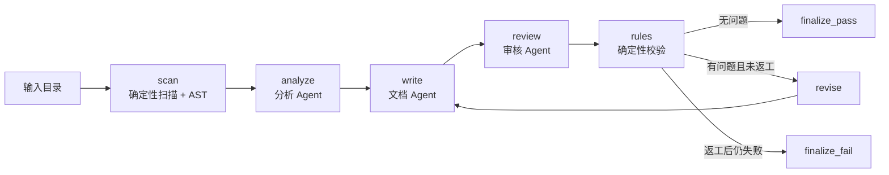

# DESIGN — 代码文档生成 Agent Workflow

## 1. 目标与约束

目标是用 **2–3 个 Agent** 完成一个可运行的简单 Workflow，展示编排、Agent 间通信和状态管理。项目选择“代码 → 分析 → 文档”方向，并额外加入独立审核 Agent。

约束：

- 运行环境：Python 3.11+，本机验证 3.12.8。
- **不下载第三方包**：仅使用标准库。
- 输入项目只读，不执行目标代码。
- 演示项目规模小，重点是可解释、可复现、可验收，而不是生产级调度。
- 模型通过 OpenAI 兼容 HTTP 接口调用；没有可用模型时可用内置 Mock 跑通编排。

## 2. 总体架构



设计原则：

1. **固定外层流程，Agent 内部有限自主**。节点顺序、条件边和循环次数由程序控制；Agent 只能在工具调用和内容生成上做选择。
2. **Agent 与普通程序职责分开**。扫描、AST、规则校验不包装成 Agent，日志中也不会冒充 Agent 输出。
3. **事实先行**。分析 Agent 先产生带源码行号的事实，文档 Agent 只能消费事实，审核 Agent 再独立回源码核对。
4. **有界执行**。工具轮数、模型重试、返工次数都有上限；失败时保存可读状态，不把失败文档标成成功。
5. **可替换**。State、Agent、模型适配器、节点和边彼此解耦。

## 3. 节点与路由

| 节点 | 类型 | 职责 | 主要输出 |
| --- | --- | --- | --- |
| `scan` | 普通程序 | 扫描文件、生成 manifest、构建 AST 索引、计算输入摘要 | `manifest[]`、`ast_index`、`source_digest` |
| `analyze` | Agent | 用只读工具阅读源码，生成带证据的事实 | `facts[]`、`unknowns[]` |
| `write` | Agent | 根据事实写 README；返工时消费审核意见 | `draft`、`draft_version` |
| `review` | Agent | 独立读取源码，核对草稿 | `review_verdict`、`review_issues[]` |
| `rules` | 普通程序 | 校验事实证据、章节、引用、审核一致性 | `rule_issues[]` |
| `revise` | 普通程序 | 复制问题到 `revision_feedback`，清空当前轮问题 | `revision_count + 1` |
| `finalize_pass` | 普通程序 | 写 `README.generated.md` 和全部产物 | `status=passed` |
| `finalize_fail` | 普通程序 | 写 `README.rejected.md` 和问题记录 | `status=needs_manual_review` |

路由规则（`Pipeline._route_after_rules`）：

```python
if not state.all_issues:                 # 审核 + 规则都没有问题
    return "finalize_pass"
if state.revision_count < state.max_revisions:
    return "revise"
return "finalize_fail"
```

`max_revisions` 默认 1。返工后必须重新经过 `review` 和 `rules`，不会直接发布。

## 4. 共享状态

`RunState` 是唯一的跨 Agent 通信载体。Agent 不直接修改它；每个节点把结果写入约定字段。

| 字段 | 含义 |
| --- | --- |
| `run_id`、`input_dir`、`output_dir`、`model` | 运行标识和上下文 |
| `status` | `running` / `passed` / `needs_manual_review` / `failed` |
| `source_digest` | 输入 manifest 的 sha256，绑定本次输入快照 |
| `manifest[]` | 文件路径、大小、行数、sha256 |
| `ast_index` | 模块、函数、类、import、argparse 子命令/参数 |
| `facts[]` | 事实编号、类型、陈述、证据（文件 + 行号范围） |
| `unknowns[]` | 无法从源码确认的内容 |
| `draft`、`draft_version` | 当前草稿和版本 |
| `review_verdict`、`review_issues[]` | 当前轮审核结论和问题 |
| `rule_issues[]` | 当前轮机械校验问题 |
| `revision_feedback[]` | 传给下一次 `write` 的问题副本 |
| `revision_count`、`max_revisions` | 已返工次数和上限 |
| `rounds[]` | 每轮 review / rules 的结论和问题历史 |
| `events[]` | 节点开始/结束/路由等紧凑事件 |
| `errors[]`、`started_at`、`finished_at` | 失败原因和时间 |

每次运行保存 `state.json`，因此可以直接查看“第一个 Agent 的事实是否真的传到了后续 Agent”。

另外提供 `scripts/make_report.py`，从一次运行的 JSON/JSONL 生成静态 HTML 查看页（执行路径、审核问题、事实证据、工具调用）。它只是查看器，不参与工作流执行；工作流本身没有网页界面。

## 5. Agent 设计

三个 Agent 使用独立提示词、输入契约和输出校验。

### 5.1 分析 Agent

- 工具：`list_files`、`read_file`、`search`。
- 必须至少成功调用一次 `read_file` 才能提交最终结果（`required_tool="read_file"`）。
- 输出：

```json
{
  "facts": [
    {
      "id": "F1",
      "kind": "entrypoint",
      "statement": "通过 python -m pkg 启动。",
      "evidence": [{"file": "pkg/__main__.py", "lines": [1, 6]}],
      "confidence": "high"
    }
  ],
  "unknowns": ["未确认是否支持并发"]
}
```

- `kind` 限定为 entrypoint / command / dependency / module / feature / data / limitation / configuration / metadata / unknown。
- 校验器检查：编号唯一、类型合法、证据文件在 manifest 中、行号范围可读且不超过文件行数。
- `read_file` 返回带真实行号的 `numbered_text`，提示词要求 final 前逐条复核，避免模型自行数行造成偏移。

### 5.2 文档 Agent

- 单次生成，不使用工具；返工时接收 `previous_draft` 和 `review_feedback`。
- 输出纯 Markdown，第一行为 `# <project_name>`，随后必须包含五个二级标题：
  `## 项目用途`、`## 安装`、`## 使用方法`、`## 主要模块`、`## 已知限制`。
- 每条功能、命令、依赖、限制引用事实编号 `[F#]`；只能引用输入中存在的编号；无法确认写“待确认”。
- 草稿写入 `drafts/draft-vN.md`，返工前后可直接对比。

### 5.3 审核 Agent

- 工具与分析 Agent 相同；必须至少成功调用一次 `read_file` 才能提交结论。
- 独立核对入口、命令、参数、依赖、限制和引用；不能只根据草稿文风判断。
- 输出：

```json
{
  "verdict": "pass | revise",
  "issues": [
    {
      "severity": "high | medium | low",
      "claim": "草稿中的结论",
      "problem": "具体错误",
      "evidence": "文件:行号 或事实编号",
      "suggestion": "可执行的修改"
    }
  ]
}
```

- 校验器强制：`pass` 时 `issues` 为空；`revise` 时至少一条问题；每条问题字段完整，且 `evidence` 必须包含真实存在的 `文件:行号`，否则要求模型修正。
- 审核 Agent 有自己的工具循环和提示词，不复用分析 Agent 的结论作为最终依据。

### 5.4 工具调用协议

模型每次返回一个 JSON 对象：

```json
{"thought": "...", "tool": "read_file", "args": {"path": "todo_cli/cli.py", "start": 1, "end": 95}}
```

或：

```json
{"thought": "...", "final": {"facts": [...], "unknowns": [...]}}
```

程序执行工具，把结果作为下一条 user 消息回填，形成真实的“模型决策 → 工具 → 观察”循环。工具异常会作为观察返回，不会直接终止整个 Workflow。JSON 模式（`response_format={"type":"json_object"}`）用于减少协议漂移；不支持该参数的兼容服务会自动回退到普通 chat completions。

## 6. 只读工具与安全

`InputSandbox` 的边界：

- 只扫描 `.py`、`.toml`、`.txt`、`.md`、`.cfg`、`.ini`。
- 忽略 `.git`、`.venv`、`venv`、`__pycache__`、构建目录、IDE 目录等。
- 最多 50 个文件，单文件最多 200 KB，单次读取最多 250 行。
- 所有路径解析后必须位于输入根目录内，拒绝 `../`、绝对路径越界和符号链接逃逸。
- 不执行目标代码，不写入输入目录。
- 工具结果截断后再回填模型，避免上下文爆炸。

## 7. 模型适配器

`ModelAdapter` 是唯一与模型供应商耦合的接口：

- `OpenAICompatibleAdapter`：标准库 `urllib` 调用 `/chat/completions`，支持 `LLM_BASE_URL`、`LLM_API_KEY`、`LLM_MODEL`、超时、温度、最大 token；HTTP 超时/连接错误/JSON 错误重试，`response_format` 不支持时回退。
- `MockAdapter`：按 Agent 名称和调用次数返回固定响应，用于离线演示和测试；它走同一消息协议，不是“假节点”。
- 所有模型调用记录耗时、字符数和 usage 到 `trace.jsonl`；密钥不写入日志或产物。

配置只从环境变量或本地 `.env` 读取，`.env` 被 `.gitignore` 忽略。

## 8. 确定性校验

`checks/rules.py` 不调用模型，检查：

- 事实存在、编号唯一、证据文件在 manifest 中、行号范围合法。
- 草稿长度合理，五个必需章节齐全。
- `[F#]` 引用存在，至少引用 3 条不同事实。
- 审核结论与问题列表一致：`pass` 不能带问题，`revise` 不能空问题。

规则问题与审核问题分开记录，二者都参与路由。

## 9. 日志与产物

每次运行目录包含：

| 文件 | 用途 |
| --- | --- |
| `README.generated.md` | 通过后的最终文档 |
| `README.rejected.md` | 未通过时的草稿，避免误用 |
| `analysis.json` | 事实、未知项、输入摘要 |
| `review.json` | 当前结论、当前问题、每轮 review/rules 历史 |
| `state.json` | 完整共享状态 |
| `trace.jsonl` | 节点、LLM 调用、工具调用、路由、错误，每行一个 JSON |
| `drafts/draft-vN.md` | 每一版草稿 |
| `manifest.json` | 输入文件清单 |

因此可以现场展示：分析 Agent 的事实编号、文档 Agent 的草稿版本、审核 Agent 的具体问题、路由结果、返工次数和最终状态。

## 10. 错误处理与状态机

```text
running ──► passed
   │
   ├──► needs_manual_review   （返工后仍有问题）
   └──► failed                （模型/协议/工具/工作流异常）
```

- HTTP 调用最多 3 次尝试；模型返回空正文时适配器自动重试；Agent 层还会追加一次纠正消息。
- JSON 解析失败最多 3 次纠正；最终结果校验失败最多 2 次纠正。
- 分析 Agent 最多 12 轮，审核 Agent 最多 12 轮；文档 Agent 最多 2 次生成尝试。
- 返工最多 1 次，超过上限进入 `finalize_fail`。
- 异常时保存 `state.json`、`analysis.json`、`review.json`、`trace.jsonl`，并写 `README.rejected.md`（若有草稿）；退出码非 0。
- 失败状态不会生成 `README.generated.md`。

真实运行中曾出现审核 Agent 连续返回非 JSON 文本的情况；工作流将其记录为 `failed` 并保存日志，没有伪造成功。之后加入 JSON 模式，重新运行恢复通过。另有一次模型返回只有空格的正文，适配器现在会先重试，仍失败才上报。复核时也出现过返工后草稿自相矛盾、审核拒绝发布的情况，最终状态为 `needs_manual_review`；这是预期的失败关闭行为。

## 11. 测试策略

`python -m unittest discover -s tests`，25 个测试：

| 类别 | 覆盖内容 |
| --- | --- |
| Workflow 三路径 | Mock pass（0 返工）、rework（1 次返工后通过）、fail（返工后仍失败） |
| 状态与产物 | 状态、轮次、草稿版本、生成/拒绝文件、`drafts/` 快照 |
| 沙箱 | manifest、读取范围、路径越界拒绝、搜索、行号检查 |
| AST | 子命令、`--data` 选项、`__main__` 保护、pyproject 元数据 |
| 规则 | 缺少章节、无效引用、无效证据 |
| Agent 校验 | 分析证据越界、审核 pass 带问题 |
| JSON | 代码围栏、前后说明文字、嵌套花括号、空响应 |
| 模型适配器 | 空正文自动重试；重试耗尽后抛出 `LLMError` |

Mock 测试证明编排正确；真实模型运行证明 Agent 确实能工作。两者职责不同，不互相替代。

## 12. 可扩展性

### 新增节点

```python
workflow.add_node("security", security_node)
workflow.add_edge("review", "security")
workflow.add_edge("security", "rules")
```

只要节点函数接收 `RunState` 并更新约定字段，就不需要改 Agent 或模型适配器。

### 新增 Agent

继承 `ToolLoopAgent`，提供独立提示词、工具集合和校验器，然后在 `Pipeline` 中注册为节点。现有三个 Agent 的输入输出契约保持不变。

### 替换模型

实现 `ModelAdapter.complete` 即可；编排、状态、日志和规则不需要修改。当前提供 Mock 和 OpenAI 兼容实现，后续可增加其他协议适配器。

### 更换输入项目

把 `--input` 指向另一个小型 Python 项目；扫描、AST、沙箱和规则均与具体项目无关。演示样本 `examples/todo_cli` 只是为了让结果可复现。

## 13. 真实运行与人工核验

| 运行 | 结果 | 说明 |
| --- | --- | --- |
| `demo/real-deepseek/` | passed，16 条事实，1 次返工 | 最终代码；审核首轮提 2 条问题，文档 Agent 返工后第二轮通过；20 次模型调用、15 次工具调用；含 `drafts/draft-v1.md` 与 `draft-v2.md` |
| `demo/real-deepseek-json/` | passed，15 条事实，0 返工 | 最终代码的全新运行；18 次模型调用、13 次工具调用；含 `drafts/draft-v1.md` |

人工抽查（`demo/real-deepseek/analysis.json`）：

- F1：`todo_cli/__main__.py:1-6`
- F7：`todo_cli/cli.py:29-30, 60-66`
- F9：`todo_cli/cli.py:34-35, 82-86`
- F10：`todo_cli/cli.py:37-38, 88-92`

早期真实运行暴露出证据行号偏移（例如 `delete` 引用到 `done` 的实现行），原因是工具当时只返回纯文本，模型需要自己数行。修正为返回 `numbered_text` 并在提示词中加入复核步骤后，行号误差被消除；这是一次由人工验收发现、再回到设计修正的迭代。

## 14. 与评分标准对应

| 评分维度 | 证据 |
| --- | --- |
| 流程完整性 40% | 一条命令从输入目录跑到最终文档；`demo/` 中有真实运行和三条 Mock 路径 |
| Agent 协作 30% | 三个独立 Agent；审核 Agent 真实读取源码并触发返工；State、`trace.jsonl`、`review.json` 记录交接 |
| 可扩展性 20% | 节点/边注册、Agent 基类、模型适配器、规则层分离；新增节点只需加函数和边 |
| 文档 10% | 本文件 + `README.md` 的安装、配置、运行、产物和限制说明 |

## 15. 限制与后续工作

- 只支持小型 Python 项目；不解析其他语言，不执行目标代码。
- 返工只回文档 Agent；如果问题出在分析事实本身，当前流程只能通过再次运行修正，不能在同一运行中回到分析节点。
- 默认一次返工；更复杂的“分析 → 文档 → 审核 → 回分析”循环需要新增状态字段和边。
- 没有网页界面、并行 Agent 和数据库持久化；这些是明确的后续扩展点。
- 模型输出仍可能遗漏信息；发布前应按 `analysis.json` 抽查证据，尤其是命令、参数和限制。
- 真实模型调用有费用；Mock 模式可完全离线复现流程。
